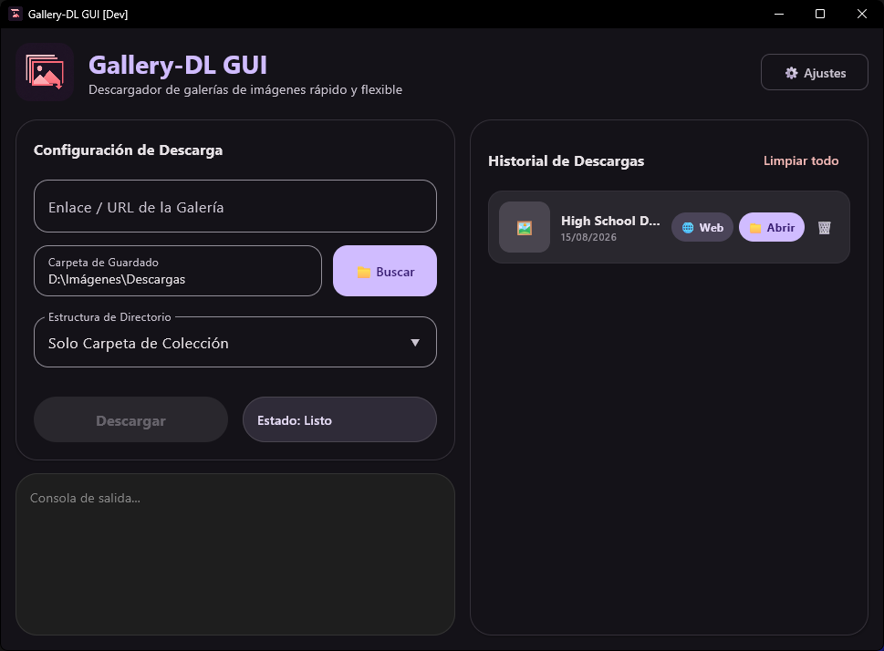

# Gallery-DL-GUI

Interfaz gráfica de escritorio para Windows construida con Kotlin y Compose Multiplatform. Facilita el uso del motor `gallery-dl` mediante una pantalla visual para iniciar descargas públicas, elegir la carpeta de destino, controlar la estructura de directorios y consultar el historial local.

Versión actual: `1.0.1`

## 📸 Capturas de Pantalla



## 📦 Descarga e instalación

La versión `1.0.1` se distribuye en Windows con dos instaladores, con sus hashes publicados en `SHA256SUMS.txt`:

| Artefacto | Uso |
| --- | --- |
| `GalleryDL-GUI-Setup-1.0.1.exe` | **Instalador recomendado.** Generado con Inno Setup (plantilla Biglex Modern 2.0), instala por usuario en `%LOCALAPPDATA%\Programs\GalleryDL-GUI` sin elevación y actualiza la versión anterior en la misma carpeta. |
| `GalleryDL-GUI-Windows-1.0.1.exe` | Instalador heredado de jpackage/WiX (Windows Installer), conservado por compatibilidad con las instalaciones MSI previas: instala en `%LOCALAPPDATA%\GalleryDL-GUI`. |

Ambos se publican en la [página de releasing de GitHub](https://github.com/biglexj/Gallery-DL-GUI/releases/tag/v1.0.1). También está disponible el manifiesto de WinGet (`biglexj.GalleryDLGUI`) en `packaging/winget/manifests/b/biglexj/GalleryDLGUI/1.0.1/`.

Los dos instaladores conviven porque usan motores, registros y rutas de instalación distintos: el de Inno Setup en `%LOCALAPPDATA%\Programs\GalleryDL-GUI` y el de jpackage/WiX en `%LOCALAPPDATA%\GalleryDL-GUI`. La guía completa está en [`packaging/windows/MIGRATION.md`](packaging/windows/MIGRATION.md).

## Organización de recursos

El icono canónico transparente se conserva en [`assets/branding/icons/icon-transparent.png`](assets/branding/icons/icon-transparent.png) y el icono con fondo de marca en [`assets/branding/icons/icon.png`](assets/branding/icons/icon.png). Los recursos de Compose y de la extensión son derivados para sus consumidores oficiales y deben seguir el [Asset Organization Standard](../Docs/global/architecture/asset-organization-standard.md).

## Estado del proyecto

Esta es una versión inicial. La compatibilidad real depende de los extractores y restricciones de cada sitio en `gallery-dl`. La aplicación no importa sesiones de navegador ni archivos de autenticación; únicamente utiliza el acceso público disponible para cada extractor.

## Funciones principales

- Descarga de imágenes y galerías compatibles con `gallery-dl`.
- Selección de carpeta de destino.
- Estructuras de salida configurables.
- Registro local de resultados, rutas y miniaturas.
- Panel de actividad y cancelación del proceso activo.

## Operación con Mise (Estándar Ecosistema)

Gallery-DL GUI implementa la interfaz universal de tareas mediante Mise:

| Tarea | Propósito |
|---|---|
| `mise dev` | Ejecutar en modo desarrollo (`:composeApp:run`). |
| `mise build` | Compilar ejecutable de escritorio (`:composeApp:packageExe`) sin generar instaladores. |
| `mise release` | Generar instalador oficial Inno Setup en `release/` sin publicar. |
| `mise publish` | Publicar en GitHub Releases y sincronizar ficha en Aurora (`--plan` y `--check` sin escritura). |

Opciones de inspección y comprobación:
- `--plan`: Muestra el comando y las operaciones planificadas sin ejecutar procesos ni modificar el sistema (`mise dev --plan`, `mise release --plan`, `mise publish --plan`).
- `--check`: (para `publish`) Verifica el estado del repositorio, tags, notas y la presencia e integridad del instalador en `release/` sin publicar nada (`mise publish --check`).
- Canal explícito `github`: `mise publish github` (omite la sincronización con la web de Aurora).

## Requisitos de desarrollo

- Windows 10 u 11.
- JDK 17 completo, con `jpackage` incluido.
- PowerShell.

Compilación y pruebas:

```powershell
.\gradlew.bat :composeApp:desktopTest :composeApp:compileKotlinDesktop --console=plain --no-daemon
```

Generación de distribuciones nativas:

```powershell
.\gradlew.bat :composeApp:packageReleaseDistributionForCurrentOS --console=plain --no-daemon
```

Antes de publicar, se debe verificar el instalador resultante en una instalación limpia y comprobar que el motor externo, la licencia y los avisos de terceros estén incluidos. El lanzamiento también debe adjuntar `gallery-dl-1.31.7-source.zip`, o cumplir mediante otro mecanismo válido de la GPL-2.0 con la entrega del código fuente correspondiente.

## Proyecto original y atribución

Gallery-DL-GUI utiliza como motor externo el proyecto libre [`gallery-dl`](https://github.com/mikf/gallery-dl), creado por Mike Fährmann (`mikf`) y sus colaboradores. El desarrollo principal de `gallery-dl` se trasladó a [Codeberg](https://codeberg.org/mikf/gallery-dl).

Esta interfaz es una adaptación independiente y no oficial. No sustituye, representa ni está afiliada con el proyecto original. La versión de Windows incluye actualmente `gallery-dl 1.31.7`; su [código fuente correspondiente](https://github.com/mikf/gallery-dl/tree/v1.31.7) debe acompañar toda publicación binaria según las condiciones de la GPL-2.0.

## Licencia

Gallery-DL-GUI se distribuye bajo la [GNU GPL v2.0](LICENSE). El motor `gallery-dl` también se distribuye bajo GPL-2.0. Consulta [NOTICE.md](NOTICE.md) para conocer la atribución, la versión integrada y los enlaces al código fuente original.

Puedes utilizar, estudiar, modificar y redistribuir este proyecto respetando las condiciones de la GPL-2.0, incluidos los avisos de autoría y la disponibilidad del código fuente correspondiente.

## Uso responsable

Utiliza la aplicación únicamente para descargar contenido que tengas derecho a guardar. Los sitios compatibles pueden modificar sus sistemas, exigir autenticación o bloquear descargas sin previo aviso.
